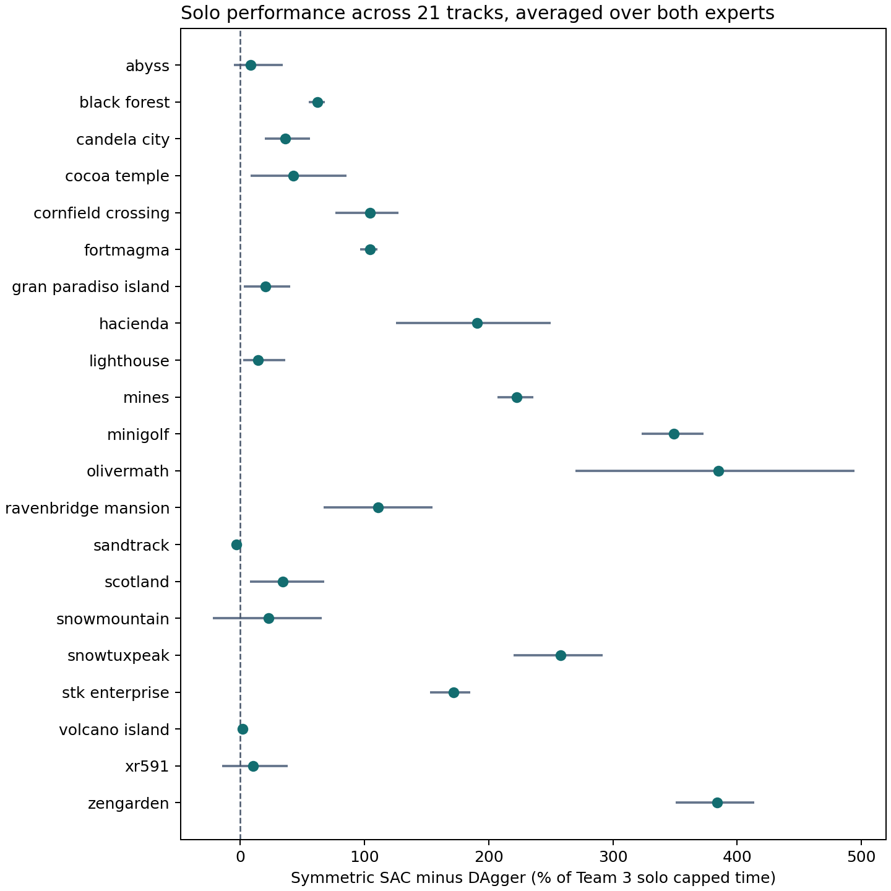
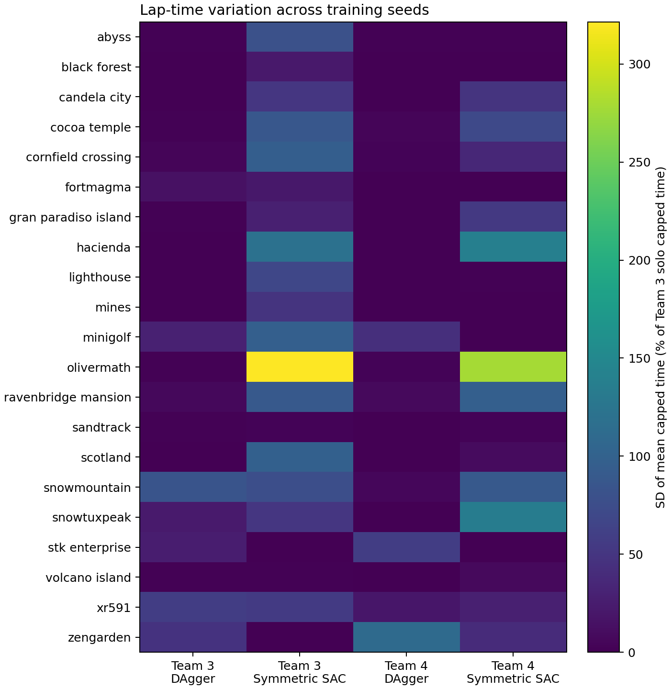

# DAgger and symmetric replay for solo SuperTuxKart time trials

*Master MIND Reinforcement Learning project · Draft 1*

## Abstract

We compared Dataset Aggregation (DAgger) with Soft Actor-Critic (SAC) using the symmetric replay rule from Reinforcement Learning with Prior Data (RLPD). We trained separate policies on 21 SuperTuxKart tracks, using two demonstration controllers and 10 training seeds per condition. At 16,384 online steps, DAgger completed 95.4% of evaluation laps and symmetric SAC completed 55.6%. Assigning 200 s to each timeout, the mean lap scores were 65.26 s and 123.61 s, respectively. The paired mean difference was 58.34 s (95% bootstrap interval 54.97 to 62.12 s). Symmetric replay improved on SAC with online-only replay. DAgger had lower variation across training seeds and a lower mean score on 20 tracks. The demonstration source changed the size of this advantage. DAgger trained from Team L’Eclair recorded a lower mean than the fastest native solo controller on three tracks. These results describe the fixed training budget, action space, and evaluation starts used in this study.

## 1. Introduction

A driver trained by behavior cloning learns from states visited by an expert. During a race, small steering errors can take the learned driver to states that are rare in those demonstrations. DAgger addresses this problem by asking the expert what to do at states encountered during training and adding the answers to the supervised dataset. Symmetric replay takes a different approach. It gives an off-policy learner a fixed share of expert transitions in every minibatch while allowing it to learn from its own actions and rewards. The methods therefore differ in when they need expert access and in how they use it. [Ross et al., 2011][dagger] · [Ball et al., 2023][rlpd]

We asked which method finishes laps more reliably and quickly at a matched online interaction budget, how the choice of demonstration controller affects the comparison, and how performance varies across seeds and tracks. Solo one-lap time trials isolate driving performance from interactions with other karts. We used behavior cloning to measure the shared starting point and online-only replay to measure the effect of symmetric sampling within SAC. [Haarnoja et al., 2018][sac] · [Raffin et al., 2021][sb3]

## 2. Methods

### Environment and controllers

Each episode used one Tux kart in headless time-trial mode at difficulty 2. The controller took over at GO. One control step advanced the simulator by 0.1 s, and a lap timed out after 2,000 steps. The learners received 32 features describing the next five track segments, their widths and validity, the vector to the track center, kart-local velocity, and energy. They controlled continuous throttle and steering.

We selected Team L’Eclair (team 3) and The Winners (team 4) as demonstration sources. In the prior five-kart controller study, The Winners finished 210 of 210 races and had the lowest mean capped time. Team L’Eclair won eight tracks by capped time, more than any other controller. The historical study motivates the choice of experts. For direct comparison with learned policies, we evaluated all five controllers again on the same solo starts. We used two action settings. Restricted controllers executed only throttle and steering, matching the learners. Native controllers could also brake, drift, use nitro, and request rescue. Both settings retained track-object observations, masked the controllers’ held power-ups, and disabled firing. [Historical controller aggregates](results/all-tracks/historical-controller-context.csv) · [Solo controller results](results/all-tracks/CONTROLLERS.md)

For each track and expert, we collected a fixed dataset of 8,192 transitions using the restricted action setting. Collection episodes used consecutive race seeds starting at 12300 and starting offsets drawn uniformly from −1.5 m to +1.5 m. We retained the first 8,192 transitions in collection order, including transitions from unfinished episodes. The same dataset initialized all methods for that track and expert. The controller source was pinned to revision `ddf2cb6573850f890bba26d4e5f82888d9dac82a`. [Controller source](https://github.com/osigaud/pystk_project/tree/ddf2cb6573850f890bba26d4e5f82888d9dac82a/src/agents)

### Training conditions

We crossed 21 tracks, two experts, and seeds 0–9 with the three online training conditions, for 1,260 training runs. Each policy trained on a single track. All three methods within a track, expert, and seed began from the same behavior cloning (BC) actor and used the same distribution of training starts. Actors and SAC critics used two hidden layers of 64 ReLU units. The shared BC actor used Adam, squared action error, a learning rate of 0.001, a batch size of 128, and 2,048 updates. For the SAC actor, the initial log standard deviation used zero weights and a bias of −2.

| Condition | Training after behavior cloning |
| --- | --- |
| DAgger | Eight rounds of 2,048 simulator steps. The expert labeled every visited state. In round `r` from 1 to 8, its action was executed with probability `0.5^r`, and the learner drove otherwise. After each round we added the new labels to the supervised dataset and ran 384 BC updates using the same optimizer and loss. |
| Symmetric SAC | Standard SB3 SAC with a replay buffer that drew 64 transitions from the frozen expert dataset and 64 from online replay, with replacement, at every gradient update. |
| Online-only SAC | The same SB3 SAC settings and BC initialization. Each update drew all 128 transitions from online replay. |

Both SAC variants used a learning rate of 0.0001, discount 0.995, target smoothing coefficient 0.005, fixed entropy coefficient 0.02, and an online replay capacity of 16,384. Training began with the first rollout and made one gradient update for every four online steps. The reward awarded 0.1 per metre of verified new on-track progress and 10 at the finish. It subtracted 0.02 per racing step and 0.08 per off-track step. We treated timeouts as truncations for bootstrapping. The symmetric arm implements the RLPD sampling rule using standard SB3 SAC critics and update schedules. The matched budget counts simulator interactions. DAgger additionally uses a live expert label at every training step, while SAC uses simulator rewards and a fixed demonstration dataset. [Training implementation](../scripts/stk_study.py) · [Reward implementation](../stk_actor/learn.py)

### Evaluation and statistical analysis

Each final policy was evaluated deterministically on 10 matched starts. Race seeds 50000–50009 corresponded to lateral offsets of −1.2, −0.9, −0.6, −0.3, 0, 0, +0.3, +0.6, +0.9, and +1.2 m at the nominal heading. We measured simulator lap time for a finish and assigned 200 s to a timeout. The primary score was the mean capped time across the 10 starts. We also report completion and mean time among finishes, which can reflect different sets of laps for different methods.

We first averaged within a policy, then computed paired differences between methods within each track, expert, and training seed. For the primary comparison, each difference was divided by the native solo mean capped time of Team L’Eclair on the same track. We averaged equally over tracks and experts within a seed and obtained 95% percentile intervals from 20,000 bootstrap resamples of the 10 paired seed blocks with random seed 17. We report the raw difference in seconds using the same procedure before normalization. The intervals describe variation across training seeds on this fixed benchmark. Track-level and controller-specific comparisons are exploratory. [Frozen protocol](STK_ALL_TRACKS_PROTOCOL.json) · [Analysis implementation](../scripts/analyze_stk_all_tracks.py)

## 3. Results

### Overall performance

| Method | Finished laps | Completion | Mean capped time | Mean time among finishes |
| --- | ---: | ---: | ---: | ---: |
| Behavior cloning | 3,874 / 4,200 | 92.2% | 70.01 s | 59.07 s |
| DAgger | 4,005 / 4,200 | 95.4% | 65.26 s | 58.70 s |
| Symmetric SAC | 2,337 / 4,200 | 55.6% | 123.61 s | 62.71 s |
| Online-only SAC | 1,801 / 4,200 | 42.9% | 143.03 s | 67.13 s |

The primary normalized gap was **+120.47% of the reference lap time** for symmetric SAC minus DAgger (95% interval +112.71% to +128.83%). DAgger also improved on the shared BC starting point by 4.75 s in mean capped time. Symmetric replay reduced SAC’s mean capped time by 19.42 s and increased completion by 12.8 percentage points relative to online-only replay. On the 2,298 matched policy-start pairs where both DAgger and symmetric SAC finished, the mean time difference was 3.55 s in favor of DAgger. This descriptive subset helps explain how much the full benchmark reflects timeouts and excludes starts where either method failed.

### Variation across tracks and training seeds

DAgger had the lower mean capped score on 20 of 21 tracks after averaging across both experts. Sandtrack was the exception. Both methods finished every evaluation lap there, and symmetric SAC averaged 1.81 s faster. The standard deviation of the 21 normalized mean method gaps was 130.01% of the reference time, reflecting the large differences in the size of DAgger’s advantage between tracks.

*Figure 1. Mean paired differences and 95% bootstrap intervals across training seeds. Positive values favor DAgger. Each track’s gap is expressed as a percentage of Team L’Eclair’s native solo mean capped time.*

Within each track and expert, we computed the sample standard deviation of the 10 policy scores. For DAgger, the median within-track SD was 1.97% of the reference time with Team L’Eclair and 1.13% with The Winners. For symmetric SAC, the medians were 54.36% and 28.01%. Across tracks, the SD of mean normalized scores was 18.80% and 44.39% for DAgger and 128.25% and 143.36% for symmetric SAC, in the same expert order. A small SD can also arise when nearly every lap reaches the timeout, so the variance must be read alongside completion. The per-track table separately records variation across starts within a fixed policy. [Per-track learner metrics](results/all-tracks/track-methods.csv)

*Figure 2. Standard deviation of policy scores over the 10 training seeds for each track, method, and expert. Scores are scaled by the same track-specific reference as in Figure 1.*

### Effect of the expert and comparison with the controllers

Replacing Team L’Eclair with The Winners increased DAgger’s normalized capped score by 9.19 percentage points (95% interval +2.53 to +15.00) and decreased symmetric SAC’s by 13.39 points (−27.43 to +1.22). The resulting change in the gap between methods was −22.58 points (−36.97 to −6.81). On Abyss, DAgger led by 12.07 s with Team L’Eclair and symmetric SAC led by 2.75 s with The Winners. These are observed means for one track. The expert switch changes the initial demonstrations for both methods and the live labels available to DAgger. [Paired results by track and expert](results/all-tracks/summary.json)

| Controller | Historical five-kart mean | Solo native mean | Solo restricted mean |
| --- | ---: | ---: | ---: |
| Tasty Crousteam | 59.65 s | 60.48 s | **65.16 s** |
| DemoPilote | 62.02 s | 59.51 s | 71.62 s |
| Team L’Eclair | 60.29 s | 57.77 s | 66.79 s |
| The Winners | **58.36 s** | **56.85 s** | 67.94 s |
| Donkey Bombs | 69.11 s | 63.53 s | 74.99 s |

Each column reports mean capped time over 210 controller starts. The Winners had the lowest mean in the historical and solo native configurations. Tasty Crousteam had the lowest overall restricted mean. Team L’Eclair had the lowest restricted mean on 11 individual tracks. [Solo controller baselines](results/all-tracks/controller-baselines.csv)

DAgger trained from Team L’Eclair had a lower mean capped score than the fastest native solo controller on Gran Paradiso Island, Mines, and Oliver’s Math Class. The margins were 0.91 s, 0.88 s, and 0.05 s, respectively. Under matched throttle and steering controls, the same DAgger condition beat the strongest restricted controller on Fort Magma and Scotland. DAgger with The Winners and symmetric SAC with either expert had zero such track wins under either action setting. These counts compare observed means against the best controller on each track. [Per-controller comparisons](results/all-tracks/learner-vs-controller.csv)

Fort Magma shows why the controller’s native performance alone is an incomplete measure of demonstration quality. The Winners finished all 10 solo evaluation laps with native controls and timed out on all 10 with throttle and steering. All five of its restricted collection episodes also timed out. Both learned methods trained from this source timed out on all 100 evaluations. With Team L’Eclair, BC finished 97 laps, DAgger finished 98, and symmetric SAC finished three. On STK Enterprise, all five Team L’Eclair collection episodes timed out, yet DAgger subsequently finished 96 of 100 evaluations while symmetric SAC finished none. The source and the way its data are used both matter. [Controller baseline results](results/all-tracks/CONTROLLERS.md)

## 4. Discussion and limitations

At the tested budget, DAgger improved on behavior cloning in completion and mean capped time. Symmetric replay improved both outcomes relative to the SAC control. Both SAC variants ended with lower completion than their BC initialization. Identifying which parts of SAC training caused this decline would require additional ablations. DAgger and SAC differ in supervision, optimization, and the actions they execute during training. Symmetric SAC can reuse a static dataset once expert collection has ended. DAgger requires an expert that can label states during training, including states outside its own trajectories.

The 200 s scoring rule gives large penalties to incomplete laps, especially on short tracks. The completion rates and matched-finish comparison show how this affects the overall gap. The statistical intervals condition on 21 fixed tracks, two chosen experts, and a fixed start grid. Each track had its own trained policy, so the study leaves generalization to unseen tracks open. The short, fixed interaction budget leaves longer-run performance open as well. Controller comparisons should distinguish the shared throttle-and-steering setting from the setting that gives controllers access to more driving actions. Testing the full RLPD recipe would require evaluating its critic architecture and update schedule. [Ball et al., 2023][rlpd]

## 5. Optuna tuning and replay ratio

We ran 12 Optuna trials for each method on four development tracks, with both experts and two matched training seeds. For each method, we selected one configuration by mean track-normalized capped time. The final comparison used the other 17 tracks, both experts, and 10 fresh training seeds, giving 2,720 held-out runs. We retrained the original settings on the same tracks and seeds to measure the effect of tuning. All five replay ratios shared the SAC settings selected at 50/50. [Follow-up protocol](STK_TUNING.md)

On four development tracks, 25/75 had the lowest mean capped time at 94.63 s and finished 118 of 160 laps. The original 50/50 setting averaged 104.41 s with 106 finishes. The 100/0 setting averaged 170.30 s and finished 30 laps. The screen used the original SAC hyperparameters and two matched training seeds. These development results describe performance under those conditions. [All five development ratios](results/tuning/REPLAY_SCREEN.md)

Optuna selected a mixing decay of 0.6444 and 768 supervised updates per round for DAgger. For 50/50 SAC it selected a learning rate of approximately 0.000150, an entropy coefficient of 0.02597, and two gradient updates per four simulator steps. Both selections doubled the number of updates relative to their original configurations. On held-out tracks, 50/50 SAC improved from 132.16 s to 101.42 s. Its paired normalized change was −54.72 percentage points (95% interval −72.66 to −37.66). DAgger improved from 63.82 s to 62.39 s, with a normalized change of −2.57 points (−7.68 to +1.60). Tuned DAgger finished 3,332 of 3,400 laps and remained ahead of tuned 50/50 SAC by 89.58 normalized points (79.86 to 100.00). [Selected trials](results/tuning/selected.json) · [Held-out results](results/tuning/RESULTS.md)

| SAC replay split (offline/online) | Finished laps | Mean capped time | Gap vs 50/50 in normalized points (95% interval) |
| --- | ---: | ---: | ---: |
| 0/100 | 2,572 / 3,400 | 96.89 s | −21.04 [−30.65, −11.82] |
| 25/75 | 2,776 / 3,400 | **88.11 s** | **−37.08 [−47.37, −25.91]** |
| 50/50 | 2,493 / 3,400 | 101.42 s | Reference |
| 75/25 | 2,299 / 3,400 | 109.48 s | +16.72 [+6.63, +26.82] |
| 100/0 | 493 / 3,400 | 181.49 s | +148.79 [+136.98, +160.37] |

With the selected SAC settings, 25/75 had the lowest capped time and the highest completion among the five ratios. It also led online-only replay by 16.04 normalized points (95% interval 4.42 to 26.60). Online-only replay scored better than 50/50 in this follow-up, whereas 50/50 scored better under the original study conditions. The follow-up changed both the optimizer settings and the evaluation suite relative to the original study, so the reversal cannot be attributed to tuning alone. The 100/0 arm collected simulator transitions at the same cadence as the other SAC arms, and its gradient batches used only fixed demonstrations. Its poor performance applies to standard SB3 SAC with this dataset and update schedule. These replay comparisons are exploratory. [Per-run results](results/tuning/test-runs.csv)

Each tuned DAgger run made 6,144 supervised updates after BC, and each tuned SAC run made 8,192 gradient updates. Mean elapsed time through training was 32.84 s for tuned DAgger and 47.31 s for tuned 50/50 SAC. These timings include BC and its evaluation, and reflect the load on the PPTI workers. [Training times](results/tuning/test-summary.json)

## 6. Conclusion

For solo SuperTuxKart at 16,384 online steps, DAgger produced lower capped times and lower seed variability than 50/50 SAC in the original study. Its advantage over 50/50 SAC persisted after tuning both methods. At the common tuned SAC settings, a 25/75 offline/online split performed best among the ratios tested. The direct solo comparisons show that strong hand-written controllers remain competitive even where DAgger improves on behavior cloning.

## Reproducibility

The campaign ran on PPTI with Python 3.12.14, PySuperTuxKart2 0.7.4, pystk2-gymnasium 0.10.0, Stable-Baselines3 2.9.0, PyTorch 2.12.0+cpu, and NumPy 2.2.6. Each learner used one CPU thread. The run records preserve every evaluated lap, policy checkpoint, demonstration hash, and BC initialization hash. The analysis checks the matched evaluation starts, sample counts, and dataset identity. The protocol contains the reproduction commands and settings. [Protocol and commands](STK_ALL_TRACKS_STUDY.md) · [Campaign results](results/all-tracks/RESULTS.md) · [AI assistance log](AI_USE.md)

## References

- Ross, S., Gordon, G., and Bagnell, D. (2011). A Reduction of Imitation Learning and Structured Prediction to No-Regret Online Learning. AISTATS. [Paper][dagger]
- Haarnoja, T., Zhou, A., Abbeel, P., and Levine, S. (2018). Soft Actor-Critic: Off-Policy Maximum Entropy Deep Reinforcement Learning with a Stochastic Actor. ICML. [Paper][sac]
- Raffin, A., Hill, A., Gleave, A., Kanervisto, A., Ernestus, M., and Dormann, N. (2021). Stable-Baselines3: Reliable Reinforcement Learning Implementations. JMLR. [Paper][sb3]
- Ball, P. J., Smith, L., Kostrikov, I., and Levine, S. (2023). Efficient Online Reinforcement Learning with Offline Data. ICML. [Paper][rlpd]

[dagger]: https://proceedings.mlr.press/v15/ross11a.html
[sac]: https://proceedings.mlr.press/v80/haarnoja18b.html
[sb3]: https://jmlr.org/papers/v22/20-1364.html
[rlpd]: https://proceedings.mlr.press/v202/ball23a.html
